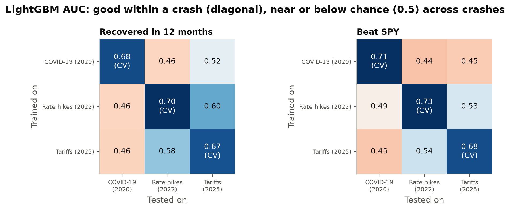
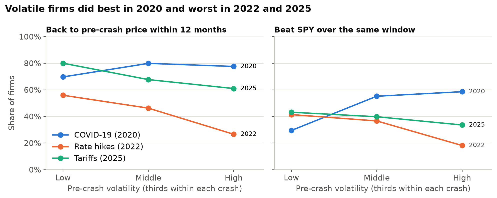
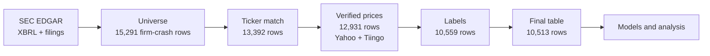

# crashRecovery

**Do the firms that recover from one stock-market crash look like the firms that recover from the next?**

This project predicts whether a U.S. public company's stock gets back to its pre-crash price after a market crash, using only what the company filed with the SEC before the crash. It covers three crashes with different causes: COVID-19 (2020), the Fed rate hikes (2022), and the tariff shock (2025). The models are trained on one crash and tested on the others. The dataset is built from SEC filings rather than today's stock listings, so firms that later went bankrupt or were delisted are still included.

**[Interactive results →](https://raajbanga.github.io/crashRecovery/)** Explore the transfer matrix, recovery curves, and all 10,513 firm-crash rows.

A full write-up is in [`report/report.pdf`](report/report.pdf), and a 14-slide summary is in [`slides/crash_recovery.pptx`](slides/crash_recovery.pptx).



## Key findings

- **Within a crash, fundamentals predict recovery.** LightGBM reaches an AUC of 0.67 to 0.70, beating a sector-and-size baseline in every crash. The bootstrap confidence interval of the gain excludes zero each time.
- **Across crashes, the same models do worse than the baseline.** Cross-crash AUC falls to 0.46 to 0.60. Trained on two crashes and tested on the third, LightGBM scores 0.055 below the baseline, pooled over all three (95% CI −0.066 to −0.044).
- **Signals change sign with the cause of the crash.** The most volatile third of firms recovered *more* often than the calmest third in 2020 (78% vs 70%), and *less* often in 2022 (27% vs 56%) and 2025 (61% vs 80%). No feature ranks in the top five with the same sign in all three crashes.
- **Even the realistic forward test fails.** Training on 2022 and predicting 2025, the most similar pair, gives 0.602 against the baseline's 0.618.
- **The result is robust.** It holds after dropping early acquisitions, using a beta-adjusted label, using within-crash percentile features, separating firms seen and unseen in training, and using a single price source.

In practice, a "crash-resilient" stock screen built on one crash shouldn't be trusted in the next unless the two crashes have a similar cause.



### Results

Within-crash AUC (5-fold cross-validation, grouped by firm), for recovering to the pre-crash price within 12 months:

| Model | 2020 | 2022 | 2025 |
|:--|--:|--:|--:|
| Baseline (sector and size only) | 0.623 | 0.670 | 0.651 |
| Logistic regression | 0.647 | 0.701 | 0.670 |
| Random forest | **0.683** | **0.709** | **0.676** |
| LightGBM | 0.678 | 0.703 | 0.674 |

| | COVID-19 (2020) | Rate hikes (2022) | Tariffs (2025) |
|:--|--:|--:|--:|
| S&P 500 drop, peak to trough | −33.9% | −25.4% | −18.9% |
| Firms in the final table | 3,216 | 3,599 | 3,698 |
| Recovered within 12 months | 75.6% | 42.8% | 69.2% |
| Median days to recovery | 247 | 539 | 142 |

The report also covers firm archetypes (k-means, HDBSCAN), recovery rules (FP-Growth), unusual firms (Isolation Forest, LOF), and recovery timing (Kaplan–Meier, Cox).

## Methodology

Each row is one firm in one crash. Features are the firm's financials filed **before** the market peak; the label is whether its stock **recovered** within 12 months of the market trough.



- **Features (16):** liquidity, leverage, profitability, cash flow, growth, and size from trailing-12-month SEC facts, plus pre-crash volatility, momentum, beta, and market value. Sector comes from the SIC code.
- **Models:** a baseline logistic regression on sector and size, compared with logistic regression, random forest, and LightGBM, all with fixed, regularized hyperparameters.
- **Evaluation:** AUC, because base rates range from 43% to 76%. Models are compared with DeLong tests (Holm-corrected across 72 comparisons) and a bootstrap that resamples whole firms. Feature importance uses SHAP.

### Guarding against bias

- **Look-ahead bias:** only SEC facts filed before the peak are used, so later restatements can't leak in. An automated check confirms it.
- **Survivorship bias:** the universe comes from SEC filers, not current tickers. Delisted firms are priced through Tiingo, and dead tickers are traced through renames (`SIVB` → `SIVBQ`).
- **Wrong-company prices:** tickers get reused, so each price series is checked against the SEC's own recorded prices, and each ticker must belong to the same issuer at the peak. This caught 11 rows priced as a different company.
- **Repeated firms:** 71% of rows belong to firms in all three crashes, so cross-validation folds and bootstrap resamples keep each firm's rows together.

## Getting started

Requires Python 3.14.

```bash
git clone https://github.com/raajbanga/crashRecovery.git && cd crashRecovery
python3.14 -m venv .venv && .venv/bin/pip install -r requirements.txt
.venv/bin/python -m ipykernel install --user --name crash-recovery --display-name "Crash Recovery (.venv)"
```

The processed tables are committed, so the classification and pattern notebooks ([`02_classification`](notebooks/02_classification.ipynb), [`03_patterns`](notebooks/03_patterns.ipynb)) run without downloading anything. [`01_explore`](notebooks/01_explore.ipynb) also needs the FRED download (step `02`), and [`04_survival`](notebooks/04_survival.ipynb) needs the raw price files.

### Rebuilding the dataset from scratch

The full pipeline downloads SEC, FRED, and price data. It needs an SEC contact string and at least one free [Tiingo](https://www.tiingo.com/) API key:

```bash
cp .env.example .env    # fill in SEC_USER_AGENT and TIINGO_API_KEY
cd scripts
for s in 01_download_sec 01b_download_submissions 02_download_fred 04a_download_ftd \
         03_build_universe 04_match_tickers 05a_download_yahoo 05_check_prices \
         05b_download_tiingo 05c_check_tiingo 05d_download_splits \
         06_build_labels 07_build_features check_data; do
  ../.venv/bin/python $s.py || break
done
```

Then run the notebooks in order (`03_patterns` saves the archetypes `04_survival` uses), and rebuild the project page with `../.venv/bin/python build_site.py`.

### Tests

```bash
cd scripts
../.venv/bin/python test_helpers.py   # DeLong test and grouped bootstrap, checked against simulated data
../.venv/bin/python check_data.py     # 34 checks on the final table: filters, labels, features, ticker identity
```

## Project structure

```
scripts/
  01–05d_*.py           download SEC, FRED, fails-to-deliver, and price data; match and verify tickers
  06_build_labels.py    clean prices, apply filters, build recovery labels and exit status
  07_build_features.py  point-in-time features from SEC filings and prices
  check_data.py         checks on the final table
  helpers.py            shared plotting style, model pipeline, DeLong test, grouped bootstrap
  build_site.py         builds docs/index.html from the processed tables
  plot_sp500_crashes.py S&P 500 crash-path figure for the slides
notebooks/              01_explore, 02_classification, 03_patterns, 04_survival
data/interim/           intermediate tables (universe, ticker map, price checks, filter counts)
data/processed/         firm_crash.parquet (final table), labels.parquet, archetypes.parquet
figures/                figures used in the report, slides, and README
docs/                   interactive results page (GitHub Pages)
report/                 LaTeX report (build with `tectonic report.tex`)
slides/                 slide deck and the script that builds it
```

## Data sources

| Source | Used for |
|:--|:--|
| [SEC EDGAR XBRL](https://www.sec.gov/search-filings/edgar-application-programming-interfaces) | Financial statements, SIC codes, filing histories, delistings and bankruptcies |
| [SEC fails-to-deliver](https://www.sec.gov/data-research/sec-markets-data/fails-deliver-data) | Ticker history and reference prices for verifying price series |
| [Yahoo Finance](https://github.com/ranaroussi/yfinance), [Tiingo](https://www.tiingo.com/) | Daily prices for listed and delisted firms |
| [FRED](https://fred.stlouisfed.org/) | S&P 500, VIX, and 10-year Treasury yield, to describe each crash |

Raw downloads aren't committed because they're large and vendor price data can't be redistributed.

## Limitations

- With only three crashes, linking transfer to crash type is an interpretation and can't be modeled directly.
- 3.4% of matched rows have no verified price. These firms are smaller and fail more often, so some survivorship bias remains, mostly in 2020.
- SIC codes are current rather than as of each crash.
- The archetypes are weak (silhouette 0.15), and the Cox proportional-hazards assumption fails for some features.

## Author

Raaj Banga
