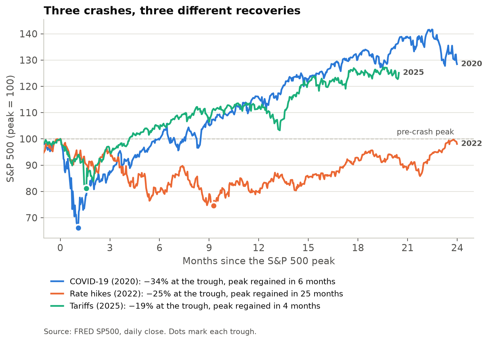
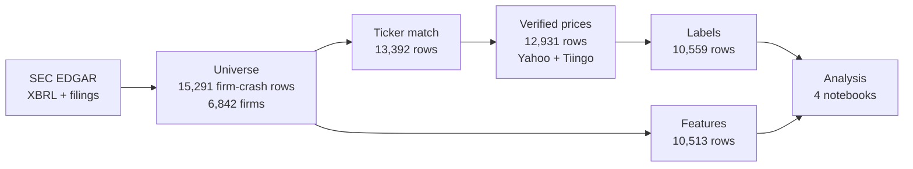

# Modeling Firm Recovery Across Three Market Crashes


**Can a firm's financials before a crash predict whether its stock recovers, and does that still hold when the next crash has a different cause?**

The project trains models on one crash and tests them on another. It uses SEC filings for every U.S. public company, including firms that later failed, so the results aren't skewed toward survivors.



The three crashes behave differently. COVID-19 was a deep, fast drop. The 2022 rate hikes were a slow grind that took two years to recover from. The 2025 tariff shock was short and shallow. A signal that predicts recovery in all three is more likely to be real than one tuned to a single event.

## Questions

| | Question | Method |
|---|---|---|
| **Prediction** | Do pre-crash fundamentals beat a sector-and-size baseline? | Logistic regression, random forest, LightGBM |
| **Transfer** | How much accuracy is lost when a model meets a crash it wasn't trained on? | Cross-crash testing, DeLong tests, bootstrap CIs |
| **Archetypes** | Do certain kinds of firms recover differently? | k-means, HDBSCAN, FP-Growth rules |
| **Exceptions** | Which firms beat or broke the odds? | Isolation Forest, LOF |
| **Timing** | How long does recovery take, and what speeds it up? | Kaplan-Meier, Cox proportional hazards |

The main result is the transfer table. Each model is trained on one crash and tested on each crash:

| Train ↓ / Test → | 2020 | 2022 | 2025 |
|---|:---:|:---:|:---:|
| **2020** | cross-validation | forward | forward |
| **2022** | backward | cross-validation | forward |
| **2025** | backward | backward | cross-validation |

Forward pairs are what real use would look like. Backward pairs and leave-one-crash-out test whether the signals hold either way.

## How it works

Each firm in each crash is one row. A row's features are its financials filed **before** the market peak, and its label is whether its stock **recovered** after the trough.



| Step | Code | What it does |
|---|---|---|
| Download | [`01`](scripts/01_download_sec.py), [`01b`](scripts/01b_download_submissions.py), [`02`](scripts/02_download_fred.py), [`04a`](scripts/04a_download_ftd.py) | SEC company facts and filing histories, FRED market series, SEC fails-to-deliver files |
| Universe | [`03_build_universe.py`](scripts/03_build_universe.py) | Starts from SEC filers, not today's listings, so firms that later failed stay in. Removes SPACs and firms without public stock. |
| Tickers | [`04_match_tickers.py`](scripts/04_match_tickers.py) | Links SEC IDs to tickers, including dead firms whose tickers changed (`SIVB` → `SIVBQ`), and checks that the ticker belonged to the firm at the peak, not just today |
| Prices | [`05a`](scripts/05a_download_yahoo.py), [`05b`](scripts/05b_download_tiingo.py), [`05d`](scripts/05d_download_splits.py) | Yahoo for listed firms, Tiingo for firms that left the market, Yahoo split histories for the unadjusted price |
| Price check | [`05`](scripts/05_check_prices.py), [`05c`](scripts/05c_check_tiingo.py) | Compares each price series with the SEC's own recorded prices to catch reused tickers, which go to a different company |
| Labels | [`06_build_labels.py`](scripts/06_build_labels.py) | Cleans prices (bad prints, missed reverse splits), drops non-common stock and firms under $1 or $10M, drops rarely traded stocks, then builds drawdown, 12-month recovery, beating SPY, days to recovery, and how the firm exited |
| Features | [`07_build_features.py`](scripts/07_build_features.py) | Point-in-time SEC facts (trailing 12 months, nothing filed after the peak): liquidity, leverage, profitability, growth, size, pre-crash volatility, momentum and beta, sector |
| Checks | [`check_data.py`](scripts/check_data.py) | 34 checks on the final table (filters, labels, features, ticker identity), plus lists for hand review |
| Analysis | [`notebooks/`](notebooks) | [`01_explore`](notebooks/01_explore.ipynb), [`02_classification`](notebooks/02_classification.ipynb), [`03_patterns`](notebooks/03_patterns.ipynb), [`04_survival`](notebooks/04_survival.ipynb) |
| Slides | [`slides/`](slides) | 14-slide deck, built by [`build_slides.js`](slides/build_slides.js) from the figures |
| Report | [`report/`](report) | LaTeX report ([`report.pdf`](report/report.pdf)), built with `tectonic report.tex` |

Shared figure style and statistics, including a fast DeLong test and a firm-grouped bootstrap, are in [`helpers.py`](scripts/helpers.py). They're checked against simulated data in [`test_helpers.py`](scripts/test_helpers.py).

### Guarding against the usual traps

- **Look-ahead bias:** features use only SEC facts filed before the peak, so restatements filed later can't leak in.
- **Survivorship bias:** dead firms come from SEC records and Tiingo, not today's ticker lists. The 3.4% of matched rows still without prices fail more often, so they're reported as a limit.
- **Wrong-company prices:** reused tickers (`PARA`, `BBBY` in 2025) are caught by matching price levels against SEC records, and by checking each ticker's issuer and name at the peak (Ambac's old ticker now belongs to Overseas Shipholding).
- **One firm, three crashes:** cross-validation folds and bootstrap resamples keep each firm's rows together.

## Data

| Source | Used for |
|---|---|
| [SEC EDGAR XBRL](https://www.sec.gov/edgar/sec-api-documentation) | Financial statements, industry codes, delisting and bankruptcy filings |
| [SEC fails-to-deliver](https://www.sec.gov/data-research/sec-markets-data/fails-deliver-data) | Ticker history and reference prices for the price check |
| [FRED](https://fred.stlouisfed.org/) | S&P 500, VIX, and 10-year yield, to describe each crash |
| [Yahoo Finance](https://github.com/ranaroussi/yfinance), [Tiingo](https://www.tiingo.com/) | Daily prices |

Raw downloads aren't in the repo, since they're large and vendor price data isn't ours to share. Derived tables are in [`data/interim`](data/interim), and the labels in [`data/processed`](data/processed).

## Run it

```bash
python3.14 -m venv .venv && .venv/bin/pip install -r requirements.txt
cp .env.example .env    # then fill in your SEC contact and Tiingo key(s)
cd scripts && ../.venv/bin/python 01_download_sec.py    # then the other steps in number order
```

Run the scripts in this order: `01`, `01b`, `02`, `04a`, `03`, `04`, `05a`, `05`, `05b`, `05c`, `05d`, `06`, `07`, then `check_data.py`. Step `06` also downloads SPY from Yahoo as the market benchmark. Then run the notebooks in order, `01` to `04`; `03` saves the archetypes that `04` uses. They use the project's `.venv` as their kernel. `06`, `07`, and `04_survival` read the raw price files, so they need the downloads above.

---

Raaj Banga
